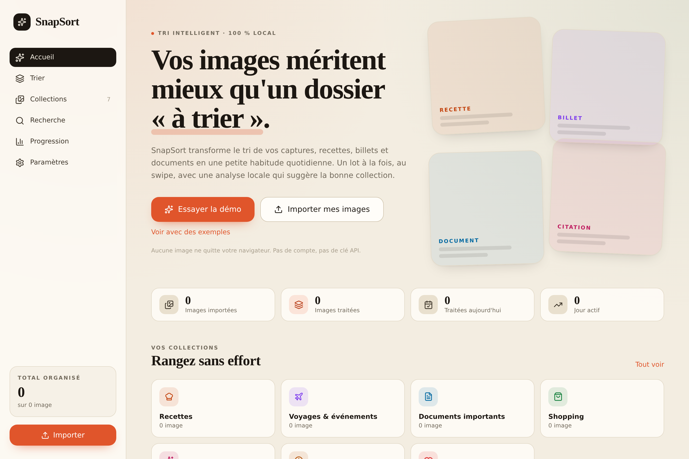
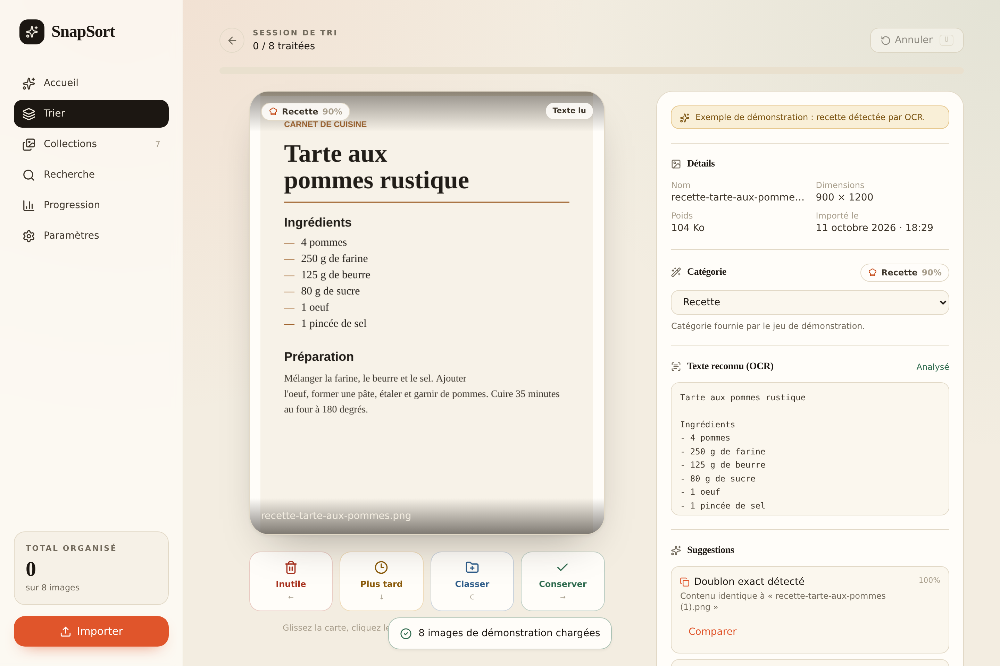
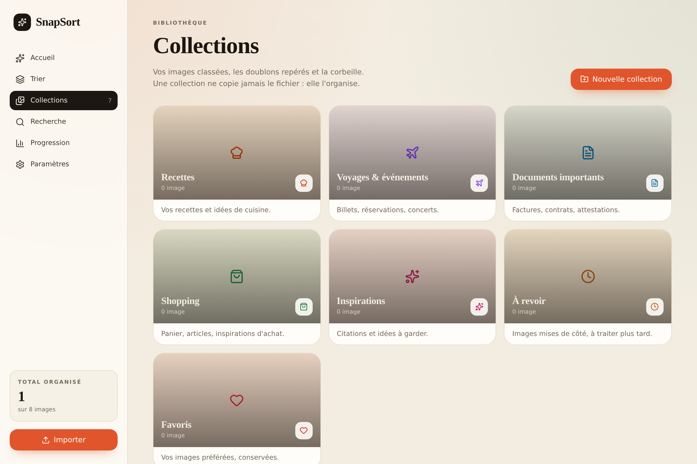
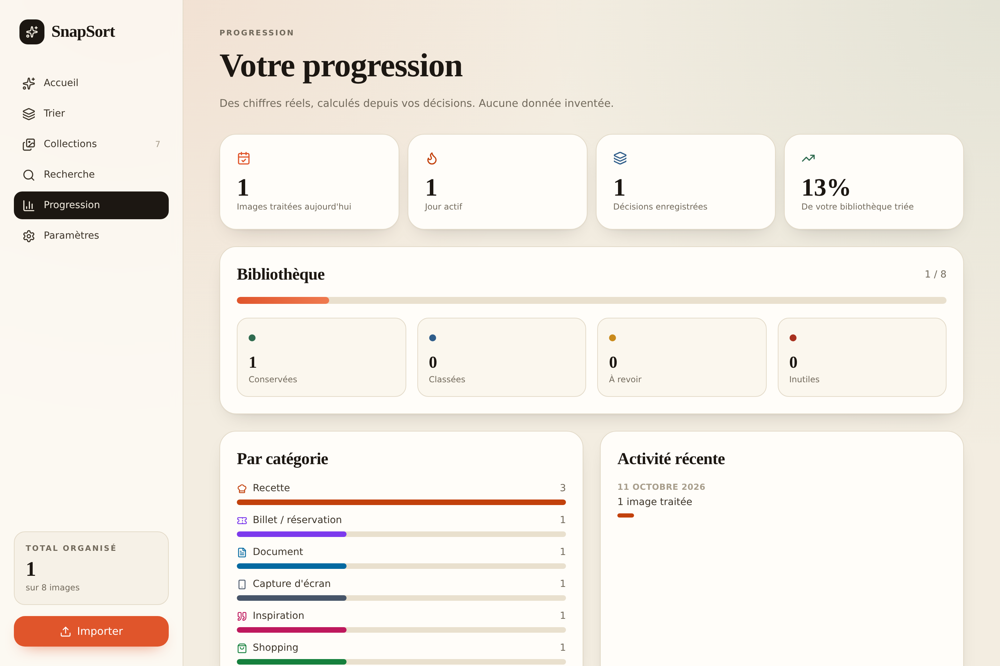
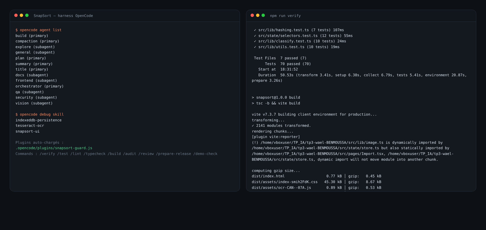

# SnapSort — tri intelligent de photos, 100 % local

SnapSort transforme le tri fastidieux de vos captures, recettes, billets et
documents en une petite habitude quotidienne. On importe ses images, on les trie
une à une au **swipe** (ou au clavier), et une analyse locale (OCR + heuristiques
+ hash perceptuel) propose des catégories, détecte les doublons et suggère une
collection. **Tout reste dans le navigateur** : pas de compte, pas de clé API,
pas de serveur.

<p align="center">
  
  
</p>

## Démarrage rapide

Prérequis : **Node.js ≥ 20** (testé avec Node 22) et npm.

```bash
npm install
npm run dev
```

Ouvrez l'adresse affichée (par défaut <http://localhost:5173>). C'est tout.

Pour tester immédiatement sans importer quoi que ce soit : cliquez sur
**« Essayer la démo »** sur l'accueil. Un jeu de 8 images est généré localement
(recette, billet, facture, capture d'écran, citation, panier, **un doublon exact
et un quasi-doublon**), avec une analyse déjà calculée et clairement étiquetée
« démonstration ». La démo fonctionne **hors ligne**.

## Fonctionnalités réellement implémentées

- **Accueil & onboarding** : proposition de valeur, statistiques, progression,
  accès direct au tri, visite guidée en 4 étapes à la première ouverture.
- **Import** : sélection multiple, glisser-déposer, validation JPEG/PNG/WebP,
  limite de taille (25 Mo) et de nombre (200), prévisualisation, retrait d'un
  fichier, progression, rapport des fichiers rejetés.
- **Tri au swipe** : grande carte, gestes gauche/droite/haut avec retour visuel,
  boutons équivalents, raccourcis clavier, annulation, barre de progression,
  taille de session configurable (5/10/15/20 ou personnalisée).
- **Décisions persistées** : chaque décision est écrite dans IndexedDB avant de
  rendre la main ; un rafraîchissement ne perd rien.
- **Analyse locale** : OCR via tesseract.js (chargé à la demande), classification
  heuristique en 8 catégories, extraction de fiche recette, suggestions de
  collection, détection de **doublons exacts** (SHA-256) et d'**images
  similaires** (dHash 64 bits).
- **Collections** : 7 collections intégrées + collections personnalisées,
  création/renommage/suppression, affectation, retrait sans suppression du
  fichier, correction de catégorie, fiche recette éditable.
- **Recherche** : par nom de fichier, texte OCR, catégorie et collection, avec
  filtres.
- **Progression** : images du jour, série de jours actifs, historique des
  décisions, répartition par catégorie et par collection.
- **Paramètres & confidentialité** : taille de session, activation OCR /
  suggestions / analyse à l'import, langue OCR, estimation du stockage, export
  JSON des métadonnées, réinitialisation de la démo et de l'espace local.

<p align="center">
  
  
</p>

## Vérifications

```bash
npm run lint        # ESLint
npm run typecheck   # tsc -b --noEmit (strict)
npm run test        # Vitest : 70 tests unitaires + intégration
npm run build       # tsc -b && vite build
npm run verify      # tout, dans cet ordre

npm run e2e:install # installe Chromium pour Playwright (une fois)
npm run e2e         # parcours de bout en bout (import, tri, persistance)
```

L'application doit être construite (`npm run build`) avant `npm run e2e`, car
Playwright démarre `vite preview`.

## Stack

- **React 19**, **TypeScript strict** (`exactOptionalPropertyTypes`,
  `noUncheckedIndexedAccess`), **Vite 7**.
- **Tailwind CSS 4** (thème personnalisé) et **framer-motion** (swipe).
- **IndexedDB** via `idb` pour la persistance locale.
- **tesseract.js** pour l'OCR, importé dynamiquement.
- **Vitest + React Testing Library**, **Playwright**.

## Architecture (résumé)

```
src/
  types.ts          Domaine : Photo, Collection, Settings, Suggestion, RecipeData
  db/database.ts    Seul accès à IndexedDB (photos, blobs, collections, history, meta)
  lib/              hashing, classify, ocr, image, demo, utils (sans React)
  state/            store (orchestration + persistance), selectors, hooks React
  components/       UI réutilisable
  pages/            Home, Import, Sort, Collections, Search, Stats, Settings
```

Les blobs sont **adressés par contenu** (`blob_<sha256>`) : deux doublons exacts
partagent le même blob, qui n'est supprimé que lorsqu'il n'est plus référencé.

## Harness OpenCode

Le dépôt est piloté par OpenCode. La configuration est dans `opencode.json`,
`AGENTS.md` et `.opencode/` :

- **Agents** (`.opencode/agents/`) : `orchestrator` (primaire), `frontend`,
  `vision`, `qa`, `security`, `docs`. Droits minimaux par rôle : `qa` et
  `security` sont en **lecture seule**.
- **Rules** (`AGENTS.md`, `.opencode/rules/`) : architecture, conventions,
  invariants, mode d'emploi du harness.
- **Commands** (`.opencode/commands/`) : `/verify`, `/test`, `/lint`,
  `/typecheck`, `/build`, `/audit`, `/review`, `/prepare-release`, `/demo-check`.
- **Skills** (`.opencode/skills/`) : `tesseract-ocr`, `indexeddb-persistence`,
  `snapsort-ui`.
- **Hooks** (`.opencode/plugins/snapsort-guard.js`) : bloque la lecture des
  fichiers sensibles, journalise ESLint après chaque édition dans `src/`.
- **CI** (`.github/workflows/ci.yml`) : lint → types → tests → build, puis e2e
  Playwright.

Les captures de l'application et du harness (agents, `npm run verify`) sont dans
`screenshots/` ; les sorties brutes de commandes sont conservées dans
`screenshots/preuves/`.

<p align="center">
  
</p>

## Confidentialité

- Les images ne quittent **jamais** le navigateur. Aucun envoi vers un serveur.
- Aucun compte, aucune clé API, aucun traceur.
- **Limite honnête** : l'OCR utilise tesseract.js. Au premier usage, le moteur et
  les fichiers de langue peuvent être téléchargés depuis un CDN puis mis en
  cache par le navigateur. Le mode démo, lui, n'a besoin d'aucun réseau.
- Le stockage local a un quota et peut être vidé par le navigateur (navigation
  privée, nettoyage). SnapSort surveille le quota et prévient ; pensez à
  exporter vos métadonnées.
- **Supprimer une image dans SnapSort ne supprime jamais le fichier original**
  de votre ordinateur.

## Limites connues

- L'OCR dépend du téléchargement initial des données de langue (voir ci-dessus).
  Sans réseau, la classification retombe sur les heuristiques (nom, dimensions)
  et la démo reste pleinement fonctionnelle.
- L'export ne contient **pas** les fichiers image, seulement les métadonnées, le
  texte OCR et les décisions (format JSON documenté dans `store.exportData`).
- Le rendu des images de démonstration utilise l'API Canvas ; il fonctionne dans
  tous les navigateurs modernes mais pas dans les environnements de test sans
  canvas (c'est pourquoi les tests le simulent).
- Pas de backend : les fonctionnalités multi-appareils ne sont pas prévues.

## Licence des ressources

Aucune image distante n'est utilisée. Toutes les images de démonstration sont
**générées localement** par `src/lib/demo.ts` (Canvas), sans dépendance externe.
